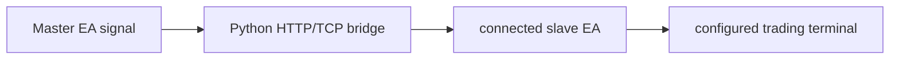

# Trading Signal Bridge

**Connect MetaTrader signal producers and consumers through a Python HTTP/TCP bridge.**

  [](LICENSE)

[Overview](#overview) · [Quickstart](#quickstart) · [Example](#example) · [Validation](#validation) · [Documentation](#documentation)

## Overview

A Python and MQL5 bridge for relaying trading signals between a local server and MetaTrader clients.

**Stack:** Python · FastAPI · TCP/HTTP · SQLite · MQL5 · MetaTrader 5

## The message path crosses two runtimes

| Component | Behavior |
| --- | --- |
| Master | MQL5 expert-advisor source produces trading signals. |
| Bridge | Python HTTP/TCP services relay messages and persist local state. |
| Slave | A configured MetaTrader client consumes updates and can execute orders. |

## Processing path



## Quickstart

```console
python -m venv .venv
# Activate .venv, then:
python -m pip install -r requirements.txt
python -m py_compile config.py database.py mt5_copy_server.py webhook_server.py
```

The commands above install prerequisites or run the specified offline checks. Live collection, cloud operations, messaging and trading are separate operational steps when present.

## Example

**Inspect the workflow**

Read a signal from the master EA, identify its HTTP payload and follow the TCP relay to a slave client. Inspect persistence and connection handling at the Python boundary. MQL5 source compilation and demo-terminal integration require MetaEditor and a separately configured terminal.

## Configuration and storage

Python FastAPI, HTTP/TCP and SQLite form the bridge; MetaTrader 5 runs the EAs. Read [config.py](config.py) before starting a server. Syntax checks do not start servers, attach expert advisors or submit orders.

## Repository guide

| Location | Responsibility |
| --- | --- |
| [mt5_copy_server.py](mt5_copy_server.py) | Signal relay |
| [webhook_server.py](webhook_server.py) | HTTP boundary |
| [database.py](database.py) | Local persistence |
| [CopyTradeDetector.mq5](CopyTradeDetector.mq5) | Master EA |
| [SlaveTrader.mq5](SlaveTrader.mq5) | Slave EA |

## Validation

The quickstart lists the declared checks. No passing CI or coverage claim is implied by the technology badges.

## Scope and operational boundaries

Slave EAs can trade when attached to a configured account. No automated end-to-end terminal suite is bundled. Python syntax validation does not compile MQL5 or prove order execution behavior.

## Documentation

- The repository guide above links directly to the implementation and configuration files.

## License and attribution

Project-authored source code is licensed under the [MIT License](LICENSE). Third-party components and datasets retain their respective rights and licenses.
