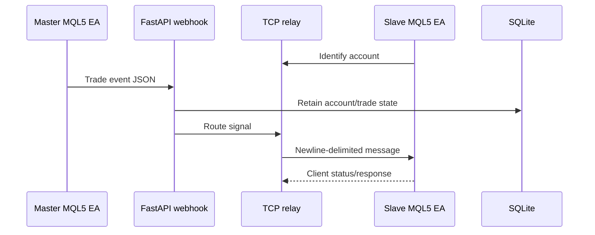

# Trading Signal Bridge

  [](LICENSE)

Bridge trade events from a MetaTrader 5 master EA through a Python server to connected slave EAs, with central account/status tracking.

The project crosses two runtimes and two transports: the master posts an HTTP webhook, while the server maintains TCP connections to clients. SQLite retains account/trade state alongside the server's connection and pending-signal state.



## Interface to inspect

[CopyTradeDetector.mq5](CopyTradeDetector.mq5) produces fields including `symbol`, `action`, `order_type`, `side`, `volume`, `price`, `ticket`, `sl`, `tp`, `timestamp` and `source`. The default symbol filter targets Gold/XAU-related names and can be configured in the EA.

[mt5_copy_server.py](mt5_copy_server.py) handles HTTP on port 8000 and TCP on 9999 by default. It buffers TCP input until newline boundaries, tracks identified clients and sends a heartbeat after a read timeout. [database.py](database.py) owns persistence; [SlaveTrader.mq5](SlaveTrader.mq5) implements the client side.

## Prepare each runtime separately

```console
python -m venv .venv
python -m pip install -r requirements.txt
python -m py_compile mt5_copy_server.py webhook_server.py database.py
```

MQL5 compilation needs MetaEditor; terminal integration needs configured WebRequest permissions and a demo environment. The server defaults to listening on all interfaces, so network exposure must be reviewed before running it. A Python syntax check does not compile the EAs or validate delivery/execution in MT5. The source can relay real trading intent; no live terminal was started for this documentation.

**Technology:** Python · FastAPI · TCP/HTTP · SQLite · MQL5 · MetaTrader 5

Project-authored source: [MIT](LICENSE). Third-party components retain their own notices and terms.
